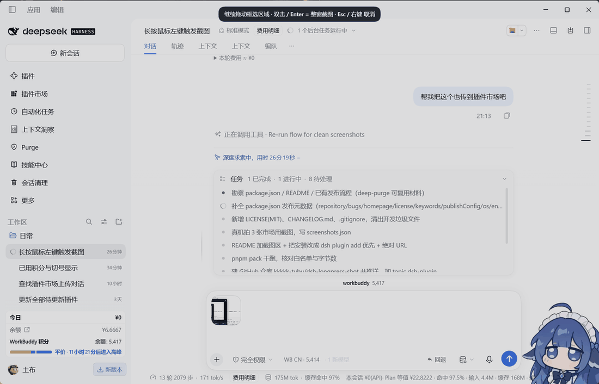
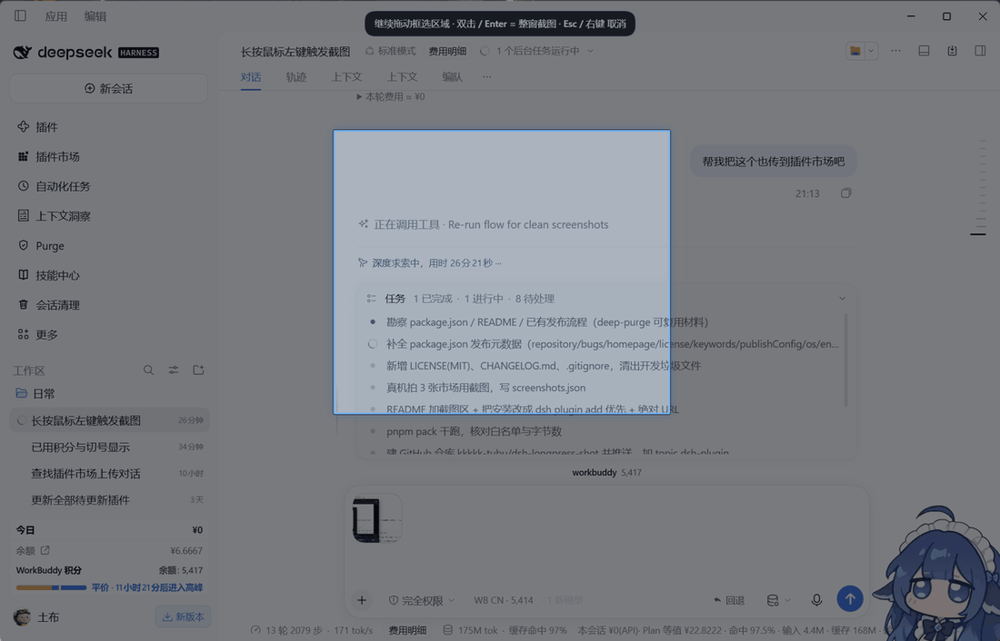
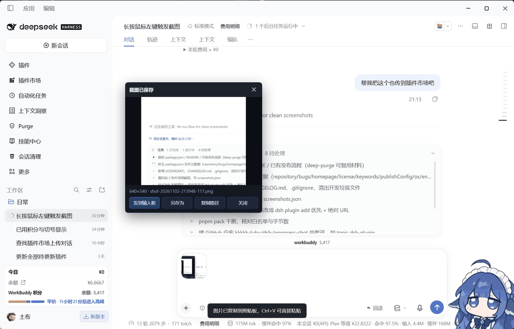
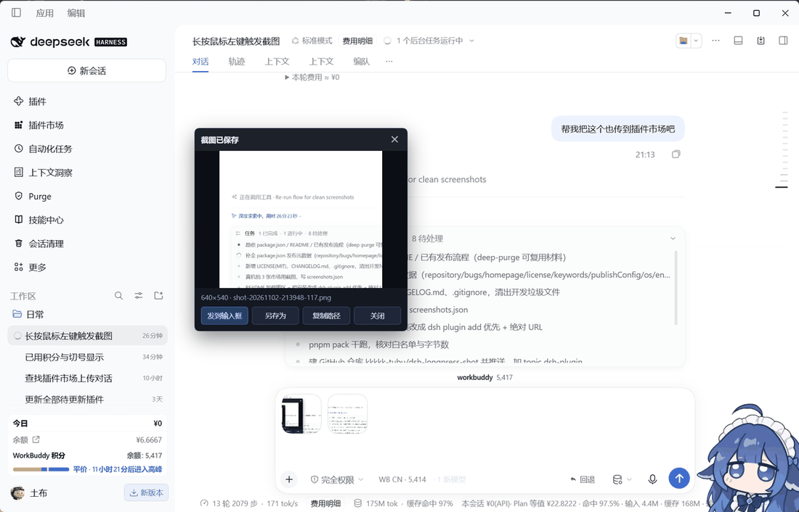

# dsh-longpress-shot

> Long-press the left mouse button anywhere in DSH, drag a box, and the region lands on disk as a PNG — with a preview card that drops the image straight into the composer.

`dsh-longpress-shot` adds region capture to DeepSeek Harness without a hotkey, a tray menu, or a separate app. Hold the left button for half a second, the page dims and turns into a crosshair, drag the area you want, release. The crop is written to `~/.dsh/longpress-shots/` and the same bytes go into the system clipboard.

Windows only (the capture path is GDI through PowerShell).



---

## Install

```bash
dsh plugin add dsh-longpress-shot
```

Or install straight from the release tarball, which needs no registry:

```bash
dsh plugin add "https://github.com/kkkkk-tubu/dsh-longpress-shot/releases/download/v1.11.2/dsh-longpress-shot-1.11.2.tgz"
```

Then restart DSH. Nothing appears in the navigation bar — the plugin works everywhere, on any page, with no entry point to find.

Manual install: put the package under `<profile>/node_modules/`, add it to the profile's `dependencies`, restart.

---

## Usage

| Action | Result |
| --- | --- |
| Hold left button ≥ 550 ms | Page dims, cursor turns into a crosshair |
| Keep holding, then drag | Blue selection box follows the pointer; release captures that region |
| Hold and release without dragging | Stays armed — press again to redraw the box (never silently captures the whole window) |
| Double-click or `Enter` while armed | Capture the whole DSH window |
| Right-click or `Esc` | Cancel |

The crop is saved as `~/.dsh/longpress-shots/shot-YYYYMMDD-HHMMSS-mmm.png`, copied to the system clipboard, and shown in a preview card with `发到输入框` (send to composer) / `另存为` (save as) / `复制路径` (copy path) / `关闭` (close).

To get the image into a conversation, use the card button, press `Ctrl+V` in the composer, or drag the thumbnail onto it — all three end up in the same attachment intake.

Drag the card by its **header** to move it; the position is remembered in `localStorage`. The default position avoids the whale widget in the bottom-right corner.

The sections below are the full engineering notes: how the capture path works, why the drop path falls back to a synthetic paste, how to run the self-tests, and how to roll back.

---

## 1. 交互细节（中文工程笔记）



| 操作 | 结果 |
| --- | --- |
| 左键按住不动 ≥ 550ms | 出现半透明遮罩，鼠标变十字 |
| 长按后**不松手继续拖** | 实时画蓝色选框，松手 → 抓该区域 |
| 长按后直接松手 | 停在遮罩里，可再按下重新拖框（不会误抓整窗） |
| 遮罩里双击 / 按 `Enter` | 抓整个 DSH 窗口 |
| 右键 / 按 `Esc` | 取消，什么都不抓 |

抓完弹预览卡：缩略图 + 像素尺寸 + 文件名，四个按钮 `发到输入框` / `另存为` / `复制路径` / `关闭`。
图片同时写进系统剪贴板，`Ctrl+V` 也可直接贴进对话框。



**把截图送进对话框，有三种方式**（按可靠度排序）：

| 方式 | 操作 | 说明 |
| --- | --- | --- |
| 按钮（推荐） | 点卡片上的 `发到输入框` | 直接把图作为附件插进输入框，立刻出现附件缩略图 |
| 粘贴 | 点一下输入框，`Ctrl+V` | 抓图时已写入系统剪贴板 |
| 拖拽 | 按住卡片缩略图拖到输入框 | 能拖就直连；Chromium 吞掉 `Files` 时由 `drop` 兜底改走粘贴通道 |

**预览卡怎么摆弄**：

| 操作 | 结果 |
| --- | --- |
| 按住卡片**标题栏**拖 | 卡片跟着鼠标走，松手后位置写进 `localStorage`，下次开在同一处 |
| 拖出窗口 / 拖到边缘 | 夹在视口内，留 8px 边距，不会被拖丢 |
| 点图片区或按钮区 | 不触发拖动（只有 header 是把手） |
| 点 `×` 或 `关闭` | 关卡片；**点在卡片上的任何事件都不会漏给桌宠** |

默认位置：视口右下角往左上偏移，**避开鲸鱼挂件**的矩形（右下角那只会说话的鲸鱼）。
鲸鱼位置从 `.dshwv-root` 的 `getBoundingClientRect()` 现算；找不到就退回右下角。

**不触发的场景**：`input` / `textarea` / `select` / `contenteditable` 内长按（不抢文本选择）。

把缩略图拖进输入框，附件缩略图立刻出现在 composer 里：



---

## 2. 目录结构

```
dsh-longpress-shot/
├── package.json          # dsh.bundle.patch → cordis.patch.yml
├── cordis.patch.yml      # 插件注册补丁
├── lib/
│   ├── index.js          # 宿主半区：注入行 + 四条路由 + 调 PowerShell
│   ├── shot.js           # 浏览器半区：长按检测、遮罩框选、预览卡
│   └── capture.ps1       # GDI 抓窗口客户区 + 按比例裁剪 + 写剪贴板
├── screenshots/          # README 用图（真机截的，1100×706）
├── screenshots.json      # 图片清单，市场页读它
├── selftest-drag.mjs     # 离线自测：假 DOM 跑完整交互状态机（9 组，全 PASS）
├── selftest-row.mjs      # 离线自测：注入行 DESKTOP_ROW_TEXT 的解析与行为（18 项，全 PASS）
├── selftest-card.mjs     # 离线自测：预览卡拖动 / 默认位置 / 事件隔离 / 送进对话框（42 项，全 PASS）
├── selftest-dragout.mjs  # 离线自测：拖缩略图出卡片 + drop 兜底（32 项，全 PASS）
├── mouse-sim.ps1         # 真机鼠标模拟：longpress / drag / click，物理像素
├── validate-profile.mjs  # 校验 profile 注册是否完整
└── sync-to-profile.sh    # 源码 → profile 同步（见第 4 节）
```

## 3. 工作原理

```
页面 pointerdown ──550ms──▶ shot.js 建遮罩（armed 继承按住这一笔）
        │                        │
        │                   pointermove → paint() 画选框
        │                        │
        └──── pointerup ─────────┴─▶ POST /dsh-longpress-shot/capture
                                    {x,y,w,h,aspect}   比例，非像素
                                            │
                                    lib/index.js 夹紧到 [0,1]
                                            │
                                    spawn powershell capture.ps1
                                            │
                             EnumWindows 找 DSH 窗口 → 客户区坐标
                             CopyFromScreen → Clone(裁剪矩形) → Save PNG
                                            │
                              {ok, file, width, height, clientW, ...}
                                            │
                         shot.js 弹预览卡 + 写剪贴板
                                            │
               ┌──── 缩略图拖到输入框 ────┐   └── 点「发到输入框」──┐
        dragstart 塞 File            宿主 drop 拿不到 Files       合成 ClipboardEvent('paste')
               │                        │（Chromium 同页 DOM 拖拽    clipboardData.items=[File]
               └───────────────────────▶│  不暴露 File）            │
                                         └──▶ pasteIntoComposer() ◀─┘
                                                    │
                                   宿主 Lexical PASTE_COMMAND 读 items
                                                    │
                                       handlers.intakeFiles(files) → 附件缩略图
```

**为什么抓屏在宿主做**：页面拿不到 OS 级截图（`getDisplayMedia` 会弹选择器）。
宿主插件跑在 Node 里，可以直接起 PowerShell 用 GDI 抓窗口客户区。

**为什么注入用内联 script 而不是 `script-src` 行**：桌面端 index.html 是安装包静态直出，
`tapIndex` 变换不生效；而 `script-src` 行加载失败会 reject 掉整个 `__DSH_BOOT_READY__`，
把 DSH 界面弄瞎。内联脚本自己 `onerror` 吞掉，路由不在时静默失败。

**为什么选区是比例不是像素**：`capture.ps1` 先 `SetProcessDpiAwarenessContext(-4)`（per-monitor v2），
之后全是物理像素；前端只知道自己 CSS 像素。传比例，两端各自换算，缩放/DPI 都能对上。

**为什么送进对话框走粘贴而不是拖放**：同页面 DOM 拖拽时，Chromium 只把 `text/*` 与
`chromium/x-drag-id` 交给 target，`DataTransferItem` 里的 `File` 到 `dragenter` 就没了
（`dragstart` 里 `types='Files'`、`drop` 里 `types='text/plain|chromium/x-drag-id'`，真机 diag 逐条对上）。
宿主 `installDocumentDropEvents` 判 `dt.types.includes("Files")`，恒假即放弃。
而 `PASTE_COMMAND` 只读 `event.clipboardData.items`，不经过 OS 剪贴板 —— 合成一个
`ClipboardEvent` 就能直接喂给 `intakeFiles`。这条是唯一稳的路，别改回拖放。

---

## 4. 改完代码怎么让它生效

**关键**：宿主读的是 profile 里那份 `lib/shot.js`，不是 workspace 里这份。
两者原本是硬链接，但 `edit`/`write` 是「写临时文件再改名」，inode 会换，链接就断了。
所以每次改完源码跑：

```bash
cd "C:/Users/19906/Documents/deepseek-harness/default-workspace/dsh-longpress-shot"
bash sync-to-profile.sh
```

脚本会判断是否已是同一 inode，是就跳过，不是就复制。

| 改了什么 | 怎么生效 |
| --- | --- |
| `lib/shot.js` | `sync-to-profile.sh` 后**不用手动刷新**：loader 每 5s 轮询 `/dsh-longpress-shot/version`，发现磁盘版本 ≠ 页面版本就自己 `location.reload()`；最多等 5–8 秒 |
| `lib/capture.ps1` | 同上，每次抓屏都是新起进程 |
| `lib/index.js` / `package.json` / `cordis.patch.yml` | `sync-to-profile.sh` 后**必须重启 DSH**（注入行和路由是启动时注册的） |

### 打包版没有 Ctrl+R

`E:/DSH/resources/app/lib/main.js` 里 `role: "reload"` 的菜单项包在 development 分支里，
打包版根本没绑 `Ctrl+R`。所以让新 `shot.js` 进页面的手段只有两条：

1. **自动（默认走这条）**：loader 每 5s 轮询版本，改完 `bash sync-to-profile.sh` 等 5–8 秒自己刷。
2. **手动**：`F12` 打开 DevTools（`toggleDevTools` 没被 development 门控，一定可用），
   在 DevTools 窗口里按 `Ctrl+R`；或托盘右键 → 退出，重开 DSH。

### 两种生效等级，别混

| 目标 | 需要什么 | 为什么 |
| --- | --- | --- |
| 新 `shot.js` 进页面 | 刷新即可 | `GET /dsh-longpress-shot/shot.js` 按 mtime 重读 + `no-store`，**每次请求都读磁盘** |
| `/version` 路由 + loader 轮询 | **重启一次 DSH** | 这两样是 `index.js` 的 `apply()` 里注册的，只在宿主启动时执行一次 |

所以「框选修复」单靠刷新就能生效；「版本自愈 loader」必须重启一次才能装进注入表。
判断当前进程有没有 loader：

```bash
curl -s -o /dev/null -w '%{http_code}\n' http://127.0.0.1:63342/dsh-longpress-shot/version
# 200 = 有；404 = 进程还在用旧 index.js，重启一次
```

验证当前路由喂的是新版：

```bash
curl -s http://127.0.0.1:63342/dsh-longpress-shot/version
# {"ok":true,"version":"1.8.0","bytes":29799}

curl -s http://127.0.0.1:63342/dsh-longpress-shot/shot.js | grep -c "version: '1.8.0'"
# 1
```

端口从运行时上下文拿（当前是 `63342`）。

---

## 5. 自测

```bash
cd "C:/Users/19906/Documents/deepseek-harness/default-workspace/dsh-longpress-shot"
ELECTRON_RUN_AS_NODE=1 "E:/DSH/DeepSeek Harness.exe" --check lib/shot.js    # 语法
ELECTRON_RUN_AS_NODE=1 "E:/DSH/DeepSeek Harness.exe" selftest-drag.mjs       # 交互状态机
ELECTRON_RUN_AS_NODE=1 "E:/DSH/DeepSeek Harness.exe" selftest-row.mjs        # 注入行本身
ELECTRON_RUN_AS_NODE=1 "E:/DSH/DeepSeek Harness.exe" selftest-card.mjs       # 预览卡
```

真机鼠标模拟（会真的动你的鼠标，物理像素）：

```bash
# 长按 (1000,400) 0.9s 后拖到 (1400,700) 松手 → 抓框
powershell -ExecutionPolicy Bypass -NoProfile -File mouse-sim.ps1 `
  -Action longpress -X1 1000 -Y1 400 -X2 1400 -Y2 700

# 在 (X1,Y1) 按住拖到 (X2,Y2) → 测卡片拖动
powershell -ExecutionPolicy Bypass -NoProfile -File mouse-sim.ps1 `
  -Action drag -X1 1959 -Y1 305 -X2 1559 -Y2 355

# 单击
powershell -ExecutionPolicy Bypass -NoProfile -File mouse-sim.ps1 -Action click -X1 1835 -Y1 1147
```

`mouse-sim.ps1` 只选 `DeepSeek Harness` 那个有标题的窗口做前台。
注意系统禁用了脚本执行时要用 `powershell -ExecutionPolicy Bypass -File`（不能用 `& .\x.ps1`）。

这台机器 PATH 里没有 node/npm/npx，所以要用 Electron 自带的 Node
（`ELECTRON_RUN_AS_NODE=1` + exe 路径）来跑 `.mjs`。

`selftest-drag.mjs` 覆盖 9 组：
1. 长按 600ms 触发遮罩
2. 不松手继续拖 → 选框尺寸正确
3. 松手 → 按选区提交（不再是整窗）
4. 长按后直接松手 → 不抓图，留在遮罩
5. 遮罩里重新按下拖框 → 正常出选区
6. `Esc` → 取消不抓图
7. `input` 上长按不触发
8. 遮罩里双击 → 整窗；第一次按下不能误判成双击
9. `Enter` → 整窗

`selftest-card.mjs` 覆盖 42 项，专测预览卡：
1. 卡片创建
2. 默认位置不与鲸鱼矩形相交、在视口内、走 `left/top` 内联定位、`right/bottom` 清成 `auto`
3. header 拖动生效（位移量精确匹配）、图片区按下不拖动、位置写 `localStorage`、松手清 `_lps-dragging`
4. `×` 的 `click` 在 **window 捕获**层被 `stopImmediatePropagation` 截断、真的关掉卡片
5. 拖完松手浏览器补发的那个 `click` 不触发按钮
6. 卡片外的 `click` / `pointerdown` 不受影响（不误伤页面）
7. 再抓一次，卡片落在 `localStorage` 记的位置
8. 拖源是 `div._lps-drag` 不是 `img`；`dataTransfer` 里有 1 个真 `File`、名字是
   `shot-*.png`、没有 `DownloadURL`、没有 `text/uri-list`
9. `[10]` 点 `发到输入框` → 合成 `ClipboardEvent` 把文件递给 composer（假 composer 读
   `items[i].getAsFile()`，断言名字与 MIME）
10. `[11]` **复现真机现象**：`dragover` 时 `types` 里没有 `Files`，宿主放弃 → 我们的
    `drop` 兜底自动改走粘贴；`dragend` 不重复插入
11. `[12]` 拖到非输入框区域不误插

**为什么必须挂在 `window` 捕获而不是 document**：鲸鱼挂件（`dsh-whale-widget`）的
`onDocClickStopper` / `onDocPointerDown` 挂在 **document 捕获**，判定用的是
`isWhaleHit()` 的**几何命中**（拿 img 的 rect + 透明像素画布算，完全不看 `e.target`）。
卡片压在鲸鱼身上时它照样认为「点在鲸鱼上」→ 吞掉 click，表现就是「点关闭结果点到桌宠」。
捕获路径 `window → document → … → target`，我们必须在 window 上先跑。

**为什么拖动结束要设 `dragSuppressOnce`**：拖拽松手后浏览器会补发一次 `click`，
它的 `target` 是拖动终点下面的元素。若终点压在 `×` 上就会误关卡片。
真实点击一定从 `pointerdown` 开始，所以 `pointerdown` 时清标记、补发的 click 吃掉。

`selftest-row.mjs` 覆盖 18 项，专治「宿主全 200、页面完全没反应」这一类：
括号/可解析、`SCRIPT_URL`/`VERSION_URL` 拼接、`()` `{}` 计数平衡，再在 `node:vm`
假环境里真跑一遍 IIFE，逐项断言真的挂了 `<script>`、真带了 `?v=`、真注册了 5s 轮询、
真发了一次 `probe`、`window` 上真设了 `__DSH_LONGPRESS_LOADER__`、第二次执行不再挂。
**这些断言必须逐项做**：注入行整段包在 `try{}catch(e){}` 里，任何 `ReferenceError`
都会被静默吞掉，「执行不抛异常」本身完全不构成证据。

后端裁剪链路的单独验证（绕开前端）：

```bash
curl -s -X POST http://127.0.0.1:51916/dsh-longpress-shot/capture \
  -H "Content-Type: application/json" \
  --data-binary '{"x":0.25,"y":0.20,"w":0.40,"h":0.35,"aspect":1.6,"clipboard":false}'
```

期望 `width`/`height` 约为 `clientW*0.40` × `clientH*0.35`（不是整窗）。端口取
`C:/Users/19906/.dsh/dsh-config-manager/running/desktop.json` 里的 `port`，重启会变。

---

## 6. 排错

| 现象 | 原因 / 处理 |
| --- | --- |
| 长按没反应 | 页面没刷新；或焦点在输入框里；`curl .../shot.js` 看路由是否 200 |
| 截图尺寸比屏幕上小一圈（约 67%） | `capture.ps1` 的 DPI 感知没生效 → PowerShell 以「虚拟化」跑，`GetClientRect` 返回 ÷1.5 的尺寸。查两处：`SetProcessDpiAwarenessContext` 声明返回 `bool`（不是 `IntPtr`）、文件**带 UTF-8 BOM**。`selftest-drag.mjs` 会打印 `clientW/clientH` |
| 改了 `capture.ps1` 但行为没变 | BOM 被编辑器/同步脚本剥掉了。`xxd -l 3 lib/capture.ps1` 必须是 `efbbbf` |
| 蓝框几乎看不见 | v1.7.0 前蓝框没有 `z-index`，被遮罩压暗后与背景只差约 18% 亮度。升级 shot.js 即可 |
| 长按**完全**没反应，但三条路由全 200、`/version` 也正常 | 注入行 `DESKTOP_ROW_TEXT` 解析失败，整段被浏览器丢弃。跑 `selftest-row.mjs` 定位；2026-10-26 就是这么挂的（多一个 `}`） |
| 一直是整窗截图 | 用的是 v1.0.0 的 shot.js（没有 `armed` 逻辑）。跑 `sync-to-profile.sh`，等 5–8 秒自动刷新（或 F12 → DevTools 里 Ctrl+R） |
| `Ctrl+R` 按了没用 | 打包版没绑这个键（`main.js` 里 reload 菜单项在 development 分支）。改用版本自愈轮询、F12 → DevTools 内 Ctrl+R、或退出重开 |
| `curl .../version` 返回 404 | 进程还在跑旧 `index.js`，`/version` 路由没注册。重启一次 DSH |
| 改完 shot.js 一直不自动刷新 | `/version` 404（同上），或页面开了多个窗口只有当前窗口有 loader |
| `抓屏失败：window-not-found` | `EnumWindows` 没匹配到客户区 ≥200×200 的 DSH 窗口，检查窗口是否最小化 |
| `抓屏失败：empty-region` | 选框太小（<8px）或比例算出来 <1px |
| `抓屏失败：timeout` | PowerShell 15s 没回，通常是被杀软拦了 |
| 提示「窗口宽高比与页面不一致」 | `aspectMismatch`：抓到的客户区宽高比和页面视口差 >8%，说明抓错了窗口 |
| 预览卡拖不动 | 只有 **header** 是把手；按在图片或按钮上不拖。`selftest-card.mjs` 第 3 组能定位 |
| 点关闭结果点了桌宠 | 事件隔离没挂到 **window 捕获**。鲸鱼用 `document` 捕获 + 几何命中，window 上才抢先。`selftest-card.mjs` 第 4 组 |
| 拖完松手卡片自己关了 | `dragSuppressOnce` 逻辑错：补发的 click 被当成真点击。`selftest-card.mjs` 第 4b 组 |
| 拖框经过预览卡后框不动、松手没截图 | v1.8.0 前遮罩 `z-index`（2147483000）低于预览卡（2147483001），指针移进卡片就被 window 捕获的 `onShield` 截断。升级 shot.js（`/version` 应为 1.11.2） |
| 拖缩略图到输入框什么都不发生 | 先看 `diag.jsonl` 的 `dragenter` 有没有 `"over":true`。没有 = 落点判定没命中（v1.11.2 修的就是这个：`ev.target` 是 composer 外层容器，`ed.contains(t)` 恒假）。有 `over:true` 却没插进去，再看 `tag=paste-inject` 的 `consumed` 是否为 `true` |
| 点 `发到输入框` 提示「没找到输入框」 | `composerEl()` 只认 `.cm-content[contenteditable]` 等可编辑区；先点一下对话输入区让 composer 挂载 |
| 预览卡盖住鲸鱼气泡 | 默认位置会避开 `.dshwv-root` 的矩形；鲸鱼挪了位置要等下次开卡才重算 |

**排查顺序**（自上而下，每步都能独立证伪一环）：

1. `curl -s http://127.0.0.1:<port>/dsh-longpress-shot/version` —— 404 说明 `index.js` 没加载，先去重启，别往下查。
2. `ELECTRON_RUN_AS_NODE=1 ... selftest-row.mjs` —— 注入行本身有没有解析错。
3. `curl -s .../shot.js | wc -c` —— 路由给的是不是当前版本（v1.11.2 = 44099 字节）。
4. 页面里 `window.__DSH_LONGPRESS_LOADER__` / `window.__DSH_LONGPRESS_SHOT__` —— 前者 1 说明注入行跑了，后者存在说明 shot.js 加载成功。两个都没有但 1、2、3 都正常 → 注入表没进这个窗口（桌面端注入表在宿主启动时一次性收集，重开一次窗口即可）。

---

## 7. 回退

**只想关掉但保留文件**：从 profile 的 `package.json` 里删掉 `dsh-longpress-shot` 依赖，
或用插件管理页停用它，然后重启 DSH。

**完全卸载**：

```bash
cd "C:/Users/19906/.dsh/profiles/desktop"
# 1) 从 package.json 的 dependencies 里删掉 "dsh-longpress-shot"
# 2) 删包
rm -rf node_modules/dsh-longpress-shot
# 3) 重启 DSH
```

**代码改坏了想退回**：改的是 workspace 里那份，profile 那份是副本 —— 直接
`git checkout`（如果 workspace 在版本控制下）或从备份恢复，再跑 `sync-to-profile.sh`。
反过来，如果 profile 那份坏了而 workspace 是好的，跑一次 `sync-to-profile.sh` 就修回来。

**注意**：profile `package.json` 里那行 `dsh-longpress-shot` 依赖一旦删掉，
下次 `pnpm install` 就会把包清掉；只删 `node_modules` 里的目录而不删依赖行，`pnpm install` 会重新装回来。

---

## 8. 安全边界

三条路由都过 `rejected()`：
- Host 必须是回环地址（`localhost` / `127.x.x.x` / `::1`），挡 DNS 重绑定
- `Sec-Fetch-Site: cross-site` 一律 403
- 有 `Origin` 时其 host 必须与 Host 一致

`/file` 只接受正则 `^shot-[0-9]{8}-[0-9]{6}-[0-9]{3}\.png$` 且 `basename(name) === name`，挡路径穿越。

`capture.ps1` 只抓**本进程祖先链上的窗口**（从 `-AncestorPid` 向上最多 10 层），不是全屏任取。

---

## 9. 版本

- **v1.11.2**（当前）— 修 v1.11.0 遗留的「有的拖法还是没反应」：

  现象：v1.11.0 上线后，点 `发到输入框` 一定成功，但**用手指拖**有时成功、有时什么都不发生。

  查 `diag.jsonl` 看到关键一列：`dragover` 里 `over=False`，而落点明明在输入框上。
  根因在 `inComposer()`：

  ```js
  // 旧（错）
  return ed === t || ed.contains(t) || t.closest('.cm-content,...')
  ```

  `drop` / `dragover` 的 `ev.target` 是 composer 的**外层容器**
  （实测依次是 `DIV.an3WzG_composerStack` → `DIV.GRgSLq_card` → `DIV.GRgSLq_input`
  → `DIV.GRgSLq_row` → `BUTTON.GRgSLq_add`），这些是 `.cm-content` 的**祖先**，
  所以 `ed.contains(t)` 恒假、`t.closest('.cm-content')` 也恒 null
  → `overComposer` 永远是 `false` → `rescue()` 第一道判据就 return
  → 拖拽不插文件。反过来只要指针恰好扫到编辑器本体（`.cm-content`），就会成功——
  这就是「时好时坏」的来源。

  改动（`lib/shot.js`）：
  1. `inComposer(t, ev)` 三个方向都认：`ed.contains(t)` / `t.contains(ed)` /
     `t.closest('.cm-content,[data-lexical-editor="true"],.cm-editor')`。
  2. 加几何兜底：指针 `clientX/clientY` 落在编辑区矩形外扩一圈
     （左右 40px、上 70px、下 30px，覆盖工具条与内边距）内也算命中。
  3. `dragenter` 也参与粘住 `overComposer`（原来只有 `dragover` 更新它），
     并用 `overComposer || inComposer(...)` 累积而不是覆盖——拖拽途中划出去一次不会清零。
  4. `rescue()` 判据改成 `overComposer || inComposer(ev.target, ev)`，
     `dragend` 的 `ev.target` 是拖源自己（`DIV._lps-drag`），靠坐标兜底也能命中。
  5. `diag` 增列：`dragenter.over`、`drop-rescue.over` / `near`。

  真机验收（2026-10-28 18:35，客户区 1919×1232 origin `(320,185)`）：
  拖拽路径 `(1160,930) → (760,1100)`，`diag` 序列为
  `dragenter ... over=True` → `drop`（`types` 无 `Files`）→
  `paste-inject {"consumed":true,"dispatched":false}` →
  `drop-rescue {"ok":true,"over":true,"near":true}` → 输入框里出现附件缩略图 + 光标。
  全程**不再弹任何提示**（v1.11.1 已把兜底提示删掉）。

  自测：`selftest-card.mjs 42 项` / `selftest-drag.mjs` / `selftest-dragout.mjs 32 项` /
  `selftest-row.mjs 18 项` 全 PASS。

- **v1.11.1** — 删掉拖拽兜底时的 toast（用户反馈「只要拖进去了就行，不用出这个提示」）。

- **v1.11.0** — 修「之前能把截图拖到对话框，现在不行了」：

  现象：卡片缩略图拖到输入框，松手什么都不发生；`diag.jsonl` 里 `drop` 事件明明有。

  查下来是**拖拽数据在 target 侧就没了**（真机 diag 逐条记录）：
  - `dragstart` 时 `types='Files'`、`nfiles=1`、名字 `shot-*.png` —— 我们的真 `File` 在。
  - 一到 `dragenter` / `dragover` / `drop`，`types` 只剩 `text/plain|chromium/x-drag-id`、
    `nfiles=0`。Chromium 对**同页面 DOM 拖拽**不会把 `DataTransferItem` 的 File 暴露给 target。
  - 宿主 `@deepseek-ai/dsh-client-ui-attachment/lib/client.js` 的
    `installDocumentDropEvents` 里 `dt.types.includes("Files")` 恒假 → `onDrop` 直接 return。

  换成**粘贴通道**就通了。宿主的 composer 是 Lexical，粘贴走
  `dsh-client-ui-conversation/lib/client.js` 里 `Je$2`（`PASTE_COMMAND`）那条命令，
  只读 `event.clipboardData.items`：`kind==='file'` → `getAsFile()` → `handlers.intakeFiles(files)`。
  这条路不碰 OS 剪贴板，所以手造 `ClipboardEvent` 就能喂进去
  （`new ClipboardEvent('paste', { clipboardData: dt })`，Chromium 支持 ClipboardEventInit 带 clipboardData）。

  改动（`lib/shot.js`）：
  1. 新增 `pasteIntoComposer(file)`：`new DataTransfer()` → `items.add(file)` →
     在 `.cm-content` 上派发 `paste`。`dispatchEvent` 返回 false（宿主 preventDefault）= 已被消费。
  2. 新增 `sendCardToComposer()` + 卡片按钮 `发到输入框`。
  3. `drop` / `dragend` 兜底：拖到输入框上但宿主因没有 `Files` 放弃时，自己走粘贴，
     `dropRescued` 防重复插入。
  4. 拖源仍是 `div._lps-drag`（v1.10.0），`img` 保持 `draggable=false`。

  `selftest-card.mjs` 扩到 **42 项**（新增 `[10][11][12]` 三组：按钮派发 paste、drop 兜底、落空白处不误插），全 PASS。

  真机验收（2026-10-28 15:40，客户区 1919×1232 origin `(320,185)`，window hwnd `525296`）：
  - 长按拖框 `(640,300)→(1000,560)` → 落盘 `shot-20261028-154437-293.png` **360×260**，1:1。
  - 点 `发到输入框` → `diag` 记 `paste-inject {"consumed":true,"dispatched":false}`，
    输入框上方**出现该截图的附件缩略图**。
  - 拖到输入框松手 → `drop`（`types` 无 `Files`）→ 同一笔自动走 `paste-inject` → 附件出现。

- **v1.10.0** — 换拖源：`img` 原生拖拽会把自己的 `File` 顶成 Chromium 虚拟文件 `file.png`
  （名字取自 URL 末段 `/dsh-longpress-shot/file`），读不出字节。改成外层 `div._lps-drag`
  当拖源、`img` 设 `draggable=false`；`onCardDragStart` 只做 `dt.items.add(file)`，
  删掉 `DownloadURL` 与 `text/uri-list`。

- **v1.9.x** — 预览卡缩略图恢复可拖、加拖放诊断（`diag.jsonl`）。

- **v1.8.0** — 修「拖框经过预览卡时框不动、松手没截图」：

  现象：长按触发遮罩后，把框拖到右侧预览卡（「截图已保存」那张）覆盖的区域，
  蓝框就停住不跟随；继续拖到卡片外面也不恢复，松手也抓不出图。

  原因不是 todo 面板、不是 `pointermove` 断流，而是**预览卡把指针事件吃掉了**：
  `._lps-overlay` 是 `z-index:2147483000`，预览卡是 `2147483001` —— 卡片在遮罩**上面**。
  指针移进卡片矩形后，命中的 `target` 变成卡片元素；而 `onShield` 挂在 **window 捕获**
  阶段（为了抢在鲸鱼之前），只要 `shieldTarget(ev.target)` 命中卡片就
  `stopImmediatePropagation()` —— 挂在 document 捕获上的 `onMove` 收不到这一笔，
  `paint()` 不再更新，框就冻住了。

  两处改动（双保险，缺一不可）：
  1. 遮罩提到 `z-index:2147483002`，压在卡片（`2147483001`）和 toast 之上 → 正常情况靶点不会再是卡片。
  2. `onShield` 开头加 `if (state.active) return` —— 框选进行中一律不接管指针事件，
     防止卡片被浏览器提升为合成层时命中测试仍然落到卡片上。

  验收（2026-10-28 13:52，客户区 1919×1232）：
  - 起手压在 todo 文字 `(700,800)` → 拖到预览卡内部 `(1400,1000)` → 落盘
    `shot-20261028-135242-199.png` **700×200**，与拖拽量 1:1。
  - 逐帧蓝框 bbox：`n1` = x700..1405 / y800..1005（右下角贴着鼠标，卡片区域被框住）。
  - 三个自测：`selftest-row.mjs` 18 项、`selftest-drag.mjs`、`selftest-card.mjs` 20 项，全 PASS。

- **v1.7.0** — 修「截出来的图尺寸不对 / 看着框选没生效」的两个真 bug：

  起因是用户报「任务这些部分截不了吗」，附图上蓝框停在 todo 面板左上角一动不动。
  查下来蓝框其实**一直在跟着鼠标走**，只是肉眼看不见；真正错的是落盘尺寸。

  1. **Bug 1：`capture.ps1` 的 DPI 声明写错了，整句静默失效。**
     ```powershell
     # 错（v1.7.0 之前）
     public static extern IntPtr SetProcessDpiAwarenessContext(IntPtr ctx);
     # 对
     public static extern bool SetProcessDpiAwarenessContext(IntPtr ctx);
     ```
     真实签名返回 `BOOL`，声明成 `IntPtr` 后 .NET 找不到匹配入口点，异常被
     `try/catch` 吃掉；退路 `SetProcessDPIAware()` 在进程已设过 DPI 上下文时也无效。
     于是 `powershell.exe` 以「未感知虚拟化」运行，`GetClientRect` 返回
     **1279×821**（= 物理 1919×1232 ÷ 1.5），`CopyFromScreen` 也只抓了左上 1/1.5 的区域
     再被渲染成整幅 —— 落盘图只有 67% 分辨率，还整体偏移。
  2. **BOM 是隐藏开关（踩过的坑，记下来）。** 同一个文件、字节只差 3 个字节：
     无 BOM → 稳定 1279×821；有 BOM → 稳定 1919×1232。原因是 `powershell.exe -File`
     读无 BOM 的 UTF-8 时按 ANSI/GBK 解码，文件里的中文注释被切坏，
     `Add-Type` 的 C# 源码跟着变了样 → 编译产物与调用行为不一致。
     **`lib/capture.ps1` 必须带 UTF-8 BOM**，`sync-to-profile.sh` 不要剥掉它。
  3. 顺带修了「看不见框」：蓝框原来没有 `z-index`，被 `z-index:2147483000` 的遮罩
     压在下面，30% 压暗 + 1.5px 边框 → 视觉上几乎不可见。现在
     `z-index:2147483600`、`2px solid #6fb2ff`、外发光，罩内压暗由 `18%` 提到 `34%`。
  4. `sync-to-profile.sh` 补上 `lib/capture.ps1` —— 之前漏了它，改了不同步。

  验收（2026-10-28 13:41，物理像素，客户区 1919×1232 origin `(320,185)`）：
  - 注入真实鼠标长按 `(900,830)` → 拖到 `(1450,990)` → 落盘
    `shot-20261028-134147-114.png` **550×160**，与物理拖拽量 1:1 完全一致。
  - `capture.ps1` 连跑 4 次全部 `client 1919x1232 -> out 960x616`（0.25/0.25/0.5/0.5 裁剪）。
  - 逐帧像素检测蓝框 bbox：`g1` 900,830→1004,874；`g2` →1204,934；`g3` →1454,994，
    右下角始终贴着鼠标。

- **v1.4.0** — 预览卡能拖了，也不再穿透到桌宠：

  修用户报的两件事：「这个框不能拖动，而且默认位置点关闭会穿透点到里面的桌宠」。

  1. **可拖动**：只有 `header` 是把手（`._lps-card header`），`pointerdown` 落在
     `[data-act]`（按钮/×）上直接 return。拖动用 `setPointerCapture` + 位移阈值
     3px（`dx*dx+dy*dy >= 9`），位置夹在视口内留 8px 边距，松手 `writePos()` 写
     `localStorage`。位置用 `left/top` 内联写（`applyPos` 里把 `right/bottom` 清成 `auto`）。
  2. **不穿透**：`SHIELD` 的 7 个事件（`pointerdown/move/up/cancel`、`click`、
     `mousedown/up`）挂在 **window 捕获**，`stopImmediatePropagation` 就地截断。
     鲸鱼挂件的 `onDocClickStopper` 挂 document 捕获 + `isWhaleHit()` 几何命中
     （不看 `e.target`），卡片压上去它照样吞 click —— window 捕获先跑才能挡住。
  3. **默认位置避开鲸鱼**：读 `.dshwv-root` 的 `getBoundingClientRect()`，卡片矩形
     与它相交就往上/往左推。
  4. 拖动松手补发的 `click` 用 `dragSuppressOnce` 吃掉（`pointerdown` 时清零），
     避免终点压在 `×` 上误关卡片。

  新增 `selftest-card.mjs`（20 项全 PASS）+ `mouse-sim.ps1`（真机鼠标模拟）。

  真机验收（2026-10-28 12:38–12:42，物理像素，DSH 窗口原点 `(309,185)` 1941×1243）：
  - 长按拖框 `(1000,400)→(1400,700)` → 落盘 `shot-20261028-123812-421.png` **267×200**
    （= 400/1.5 × 300/1.5，150% 缩放对得上），预览卡出现在右侧且不与鲸鱼相交。
  - header 拖动 `(1959,305)→(1559,355)` → 卡片左移约 395、下移约 50 物理像素，与拖拽量一致。
  - 点 `×` 关闭 → 卡片消失，鲸鱼无反应。
  - **最极端**：把卡片拖到鲸鱼身上（气泡被压住），再点 `关闭` → 卡片正常关闭，
    鲸鱼既不弹话也不做动作。

  教训：`edit`/`write` 是「写临时文件再改名」，inode 会换 → 与 profile 的硬链接断掉，
  改完必须 `bash sync-to-profile.sh`。另外真机截图坐标是**相对窗口图像**，
  传给 `mouse-sim.ps1` 前要加上窗口原点 `(309,185)`，否则点偏。

- **v1.2.0** — 修「重启后长按彻底没反应」：

  新增的 loader 注入行 `DESKTOP_ROW_TEXT` 里，`probe()` 结尾写成
  `...then(pick).then(apply)}` + `}).catch(...)`，`}})` 多一个 `}`。
  **浏览器在解析期就整段丢弃这个 `<script>`**，连它自己的 `try{}catch` 都进不去，
  所以 `shot.js` 一次都没被加载。表现极具误导性：三条路由全 200、`/version` 返回
  `{"ok":true,"version":"1.1.0"}`、`shot.js` 字节数也对，只有页面上什么都不发生。

  修法：删掉那一个 `}`，`new Function(DESKTOP_ROW_TEXT)` 从
  `SyntaxError: missing ) after argument list` 变成 OK。
  新增 `selftest-row.mjs`（18 项）把这类错误钉死在自测里 —— 把旧代码放回去它会报 10 项 FAIL。

  教训：注入行是「字符串拼出来的 IIFE」，拼错一个括号是**静默全灭**，不是局部失效。
  所以 `--check lib/index.js` 通过**不代表**注入行可用（`index.js` 语法没问题，
  坏的是它拼出来的那个字符串），必须单独跑 `selftest-row.mjs`。

- **v1.1.0** — 两件事：
  1. **修框选**：`beginSelection` 以 `armed=true` 继承"按住这一笔"，遮罩不再等新的
     `pointerdown`（按键已经按下，系统不会再发一次，原来 `dragging` 永远 false → 每次落整窗）。
     双击改自己判（`ev.detail` 会被触发那一次点击污染）；加 `Enter` 抓整窗。
  2. **版本自愈**：新增 `GET /dsh-longpress-shot/version`，注入行里带 loader 每 5s 轮询，
     版本不一致就 `location.reload()` —— 解决打包版没有 `Ctrl+R` 的问题。

  验收记录（2026-10-26 20:45）：模拟 `(600,400) → (900,650)` 长按拖拽，
  落盘 `~/.dsh/longpress-shots/shot-20261026-204542-085.png` 尺寸 **300×250**，与选区一致。

- v1.0.0 — 初版，框选实际不可用（`dragging` 永远 false → 每次落整窗）。
